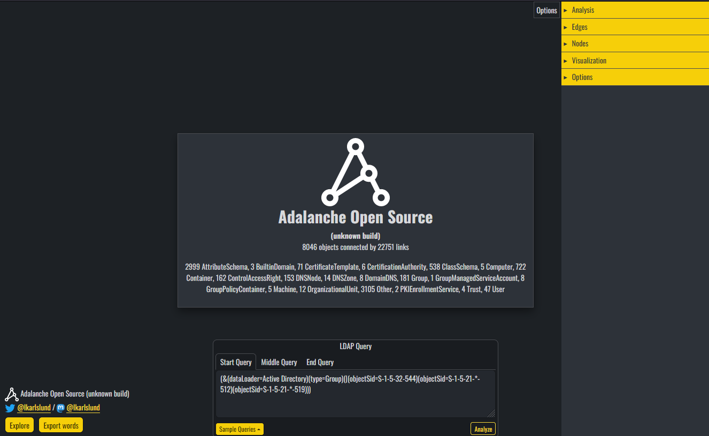
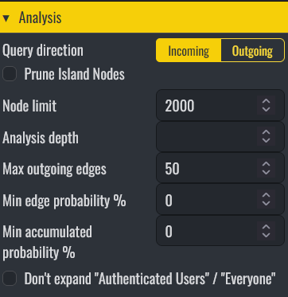
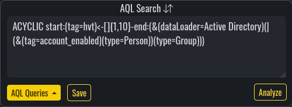
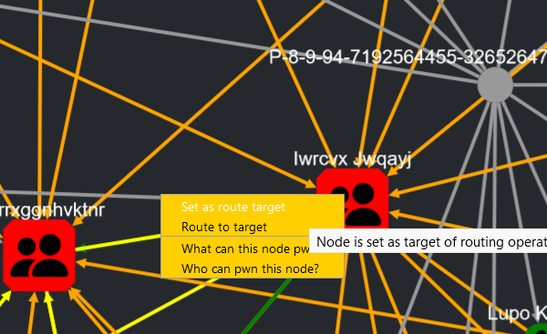
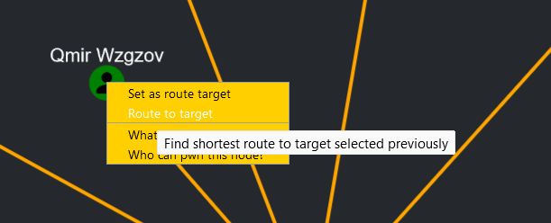
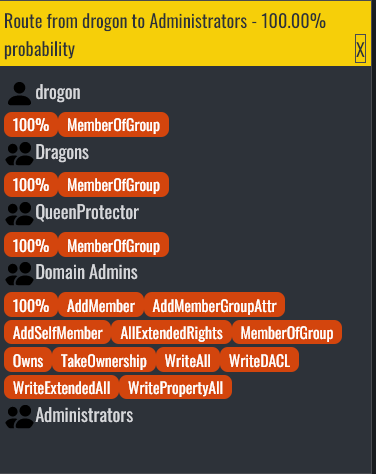

# User Interface

When launched, you will see loaded object/edge statistics and analysis controls.

The default query is intended to show paths toward privileged targets.

## Pre-defined searches

Use the built-in query list in the AQL Search panel.

## Analysis options

### Node limit

Default is 2000. If results exceed this, Adalanche removes some nodes to keep browser performance manageable.

### Max analysis depth

Controls traversal depth. `0` only evaluates initial node filters; `1` includes immediate neighbors.

### Minimum edge probability

Filters out edges below the specified edge probability threshold.

### Minimum accumulated probability

Filters out paths below the specified accumulated probability threshold.

### Prune isolated nodes

Removes nodes with no connecting edges from results.

## AQL Search panel

You can run built-in queries, edit current queries, and save your own user-defined queries.

See [AQL syntax](aql.md#aql-syntax).

## Tagged nodes

Adalanche tags nodes to make quick filtering easier.

| Tag | Description |
| --- | ----------- |
| hvt | High Value Target |
| role_domaincontroller | Domain Controller machines |
| role_readonly_domaincontroller | Read-Only Domain Controller machines |
| role_certificate_authority | Certificate Authority machines |
| laps | Machine is detected as having LAPS deployed |
| kerberoast | Account is kerberoastable |
| asreproast | Account is AS-REP roastable |
| windows | Machine is running Windows |
| linux | Machine is running Linux |
| unconstrained | Account has unconstrained delegation |
| constrained | Account has constrained delegation |
| computer_account | Domain-joined computer account |
| domaincontroller_account | Domain controller account |
| account_disabled | Account is disabled |
| account_enabled | Account is enabled |
| account_locked | Account is locked |
| account_expired | Account is expired |
| account_active | Account is enabled and not expired |
| account_inactive | Account is disabled or expired |
| password_cant_change | Password cannot be changed |
| password_never_expires | Password does not expire |
| password_not_required | Password is not required |

Search by these via the `tag` attribute.

## Edges

Adalanche detects many relationships between nodes and represents them as edges.

This list is not exhaustive; see the full list in the UI.

Informative edges have probability 0: they record a fact without being a step an attacker takes on its own, so queries leave them out unless asked for, with `probability>=0` in the edge filter (see [AQL](aql.md)).

In the enterprise version†, each domain has a synthetic *New computer account* node: a computer account that whoever can add one to the domain would control. It is a member of Domain Computers and Authenticated Users, like any computer account added, so from it a query reaches what those can do; AddComputerAccount and CreateComputerAccount lead to it.

| Edge | Explanation |
| -------- | ----------- |
| ACLContainsDeny | ACL contains deny entries that may affect interpretation |
| AddComputerAccount† | Can add a computer account to the domain: holds "Add workstations to domain" on its domain controllers, within `ms-DS-MachineAccountQuota` (informative; leads to the domain's *New computer account* node) |
| AddMember | Can change group members via `member` |
| AddSelfMember | Can add/remove itself as a member |
| AllExtendedRights | Has all extended rights |
| CertificateEnroll | Can enroll in a certificate template |
| CreateComputer, CreatePerson, CreateGroup, …† | Can create objects of that class in the container, as its ACL delegates (informative) |
| CreateComputerAccount† | Can create computer objects in an object the schema allows them in (such as a container, OU or the Builtin container), as its ACL delegates, which no quota limits (informative; leads to the domain's *New computer account* node) |
| DCReplicationGetChanges | Can replicate non-confidential DC data |
| DCsync | Combined replication rights enabling DCSync |
| DeleteObject† | Can delete the object, by Delete on it or DeleteChild on its container (informative) |
| GenericAll | Broad control similar to ownership |
| HasProfile | Has a user profile on the machine: logged on there at some point, with when it was first and last used (informative) |
| LocalAdminRights | Local admin rights detected from GPO/collector data |
| LocalRDPRights | Can RDP to target |
| MemberOfGroup | Group membership relation |
| Owns | Owns object |
| ReadLAPSPassword | Can read LAPS password |
| ResetPassword | Can reset account password |
| SeMachineAccountPrivilege, SeBackupPrivilege, SeDebug, … | Holds the user right on the machine, from the machine's own collection or from the GPOs that apply to it (for each right, the GPO applied last that assigns it decides) |
| WriteDACL | Can modify DACL |
| WriteSPN | Can modify SPN |

## Right-click menus

Right-click a node for:

- **Set as route target**, and **Plot route to target**, to draw the route from another node to it (see below)
- **Expand node**, or **Expand merged nodes**, where there is more to show
- **What can this node reach?** and **Who can reach this node?**, which run the query for it
- **Edit tags…**\*, to add and remove the node's [tags](tags.md)

Right-click an edge for:

- **Show edge details**: its edge types, their probabilities, and why each exists
- **Edit edge tags…**\*, to tag one edge type or every edge between the two nodes, see [tags](tags.md)

\* Enterprise version, with the `tags` license feature.

† Enterprise version, with the `adplus` license feature.

## Plotting a path in the GUI

Right-click target object and set as target:

Then right-click source and route to target:

If a route exists, it is displayed:

